# 核心业务流程优化流程图

> 生成日期：2026-07-13
> 更新日期：2026-07-21（v1.3 部署修复：mysql-grants、tmpfs、Nginx ^~、小程序图片路径适配）
> 基于代码逻辑分析报告，梳理7个核心业务流程并标注优化点

---

## 1. 项目管理流程

### 1.1 创建项目

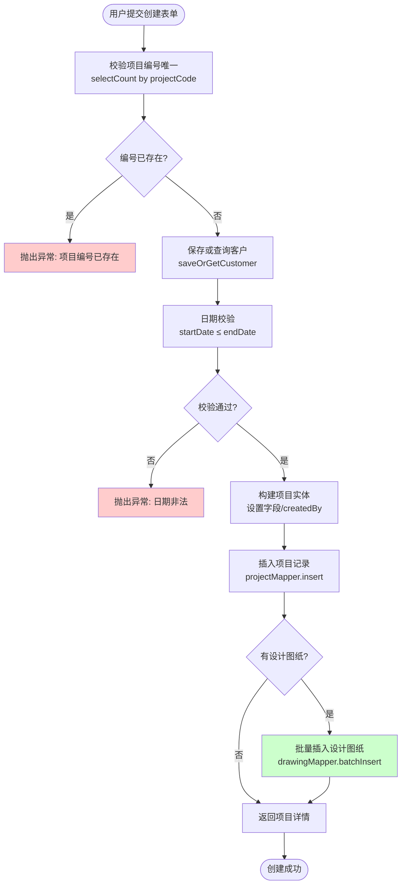

### 1.2 更新项目

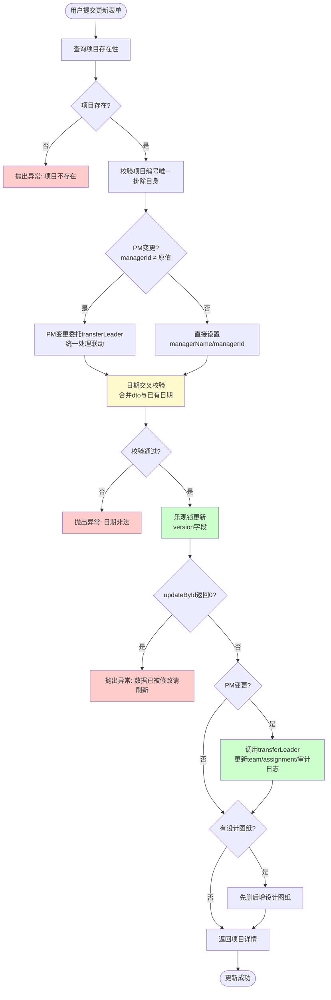

> **优化点（黄色标记）**：日期交叉校验应合并DTO日期与已有日期做完整比较，当前仅校验DTO同时传入两个日期的情况。

### 1.3 删除项目（含优化建议）

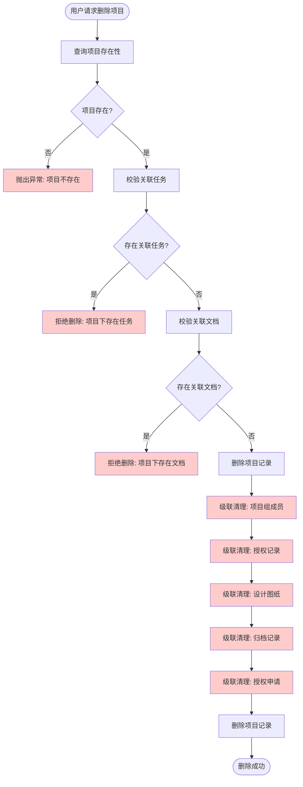

> **优化点（红色虚线标记）**：当前实现缺少级联清理步骤（L-P），会导致项目组、授权记录、设计图纸、归档记录等成为孤儿数据。建议在删除项目记录前级联清理关联数据，或改为软删除（`is_deleted=1`）保留数据可恢复。

---

## 2. 任务进度审核流程

### 2.1 任务创建与删除

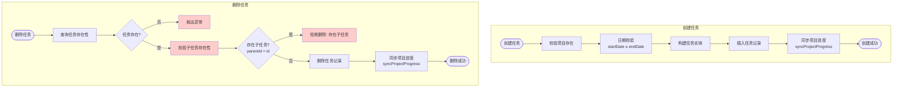

> **优化点（红色标记）**：当前删除任务未校验子任务存在性（E2-F2-G2），可能导致子任务的parentId指向已删除的任务。建议删除前检查 `biz_task.parent_id = id` 的记录数。

### 2.2 进度填报与审核流程

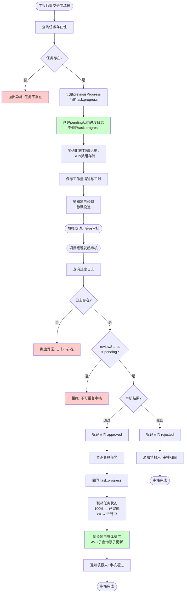

> **关键设计说明**：
> - 进度填报不直接修改任务进度，采用审核流程确保数据准确
> - 项目进度同步使用 `UPDATE ... SET progress = (SELECT AVG(progress) FROM biz_task WHERE project_id = ?)` 原子操作，消除并发覆盖
> - 建议确认SQL使用 `IFNULL(AVG(progress), 0)` 防止任务全部删除后返回NULL

---

## 3. 项目授权流程

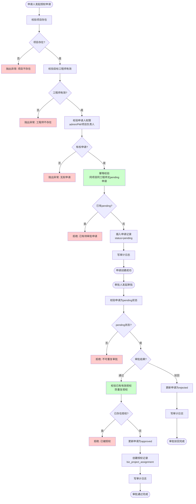

> **关键设计说明**：
> - 双重幂等校验：申请阶段防重复pending申请，审批阶段防重复授权
> - 审计日志完整记录操作类型、操作人和意见
> - 事务保证审批状态更新与授权记录创建的原子性

---

## 4. 文档管理流程

### 4.1 文档CRUD

```mermaid
flowchart TD
    subgraph 创建文档
        A1([创建文档]) --> B1[校验项目存在]
        B1 --> C1[生成文档编号<br/>DOC + UUID前8位]
        C1 --> D1[插入文档记录]
        D1 --> E1[插入初始版本 V1.0]
        E1 --> F1[保存标签]
        F1 --> G1([创建成功])
    end

    subgraph 更新文档
        A2([更新文档]) --> B2[查询文档存在性]
        B2 --> C2[非空字段选择性更新]
        C2 --> D2{标签有变更?}
        D2 -->|是| E2[先删旧标签关联]
        E2 --> F2[保存新标签]
        D2 -->|否| G2[更新文档记录]
        F2 --> G2
        G2 --> H2([更新成功])
    end

    subgraph 删除文档
        A3([删除文档]) --> B3[查询文档存在性]
        B3 --> C3[事务内: 先删DB记录]
        C3 --> D3[注册afterCommit钩子]
        D3 --> E3{事务提交成功?}
        E3 -->|是| F3[删除物理文件<br/>失败仅记录日志]
        E3 -->|否| G3[事务回滚<br/>物理文件保留]
        F3 --> H3([删除成功])
        G3 --> I3([删除失败回滚])
    end

    style C1 fill:#ffcccc
    style F3 fill:#ccffcc
    style D3 fill:#ccffcc
```

> **优化点（红色标记）**：文档编号当前使用 `DOC + System.currentTimeMillis()`，并发时可能重复。建议改为 `DOC + UUID前8位` 确保唯一性。
>
> **安全设计（绿色标记）**：删除文档采用"先删DB后删文件"策略 + afterCommit钩子，确保事务回滚时物理文件不丢失。

### 4.2 文档版本管理（含优化建议）

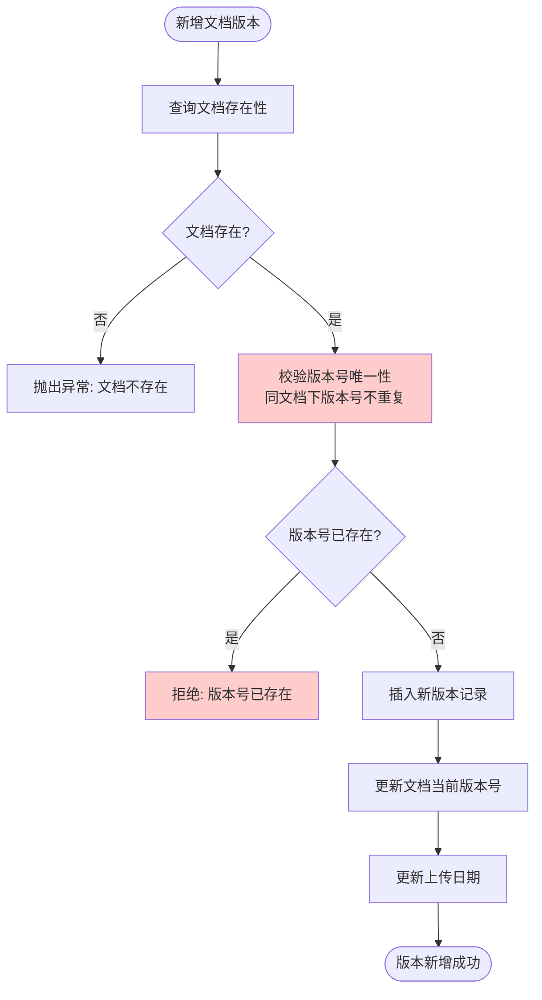

> **优化点（红色标记）**：当前 `addVersion` 方法未校验版本号唯一性（E-F-G），可能产生重复版本号。建议在插入前检查 `biz_document_version` 表中同 `document_id` 下是否已存在相同 `version`。

---

## 5. 认证与Token刷新流程

### 5.1 登录与登出

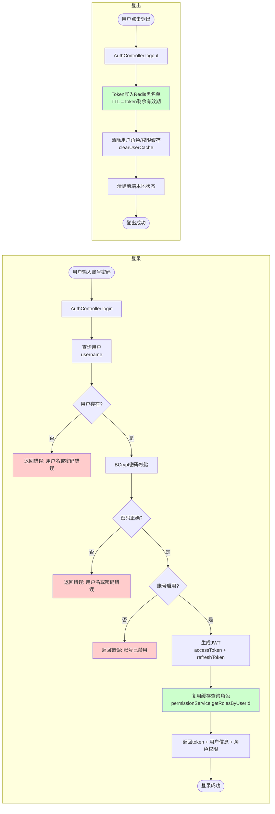

> **优化点（绿色标记）**：登录时复用缓存查询角色（L1），避免直接查DB。登出时Token写入Redis黑名单 + 清除用户缓存，双重保障。

### 5.2 Token刷新协调器流程

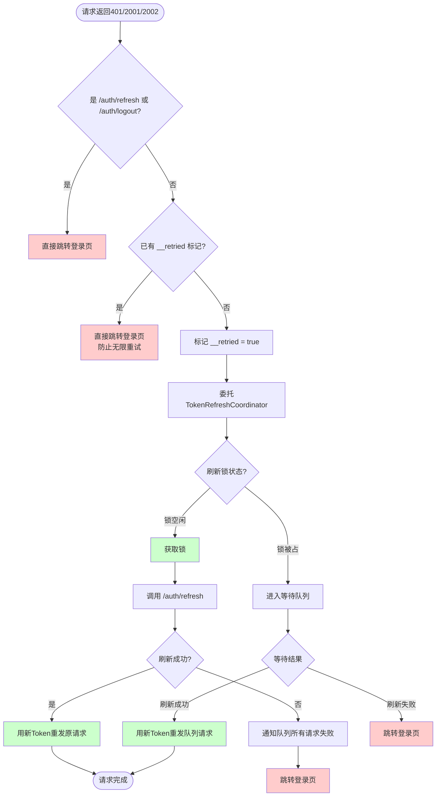

> **关键设计说明**：
> - `__retried` 标记防止同一请求无限重试（P0修复：业务码401死循环）
> - `/auth/refresh` 自身返回401时直接跳登录，避免死锁
> - "锁+队列"机制确保并发401只触发一次刷新
> - 刷新成功后所有队列请求自动重发

### 5.3 请求拦截与认证流程

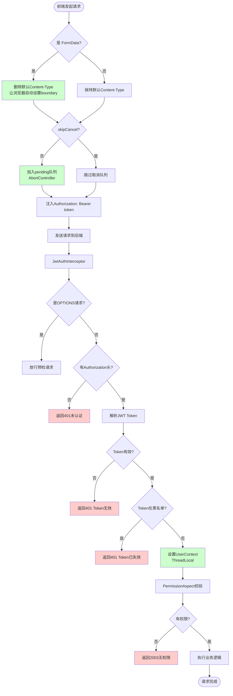

> **关键设计说明**：
> - FormData请求自动删除Content-Type（修复文件上传boundary缺失问题）
> - JWT认证三重校验：Token有效性 + 黑名单检查 + 权限校验
> - UserContext在afterCompletion中清理，防止ThreadLocal泄漏

---

## 6. 通知批量发送流程

### 6.1 单条通知投递

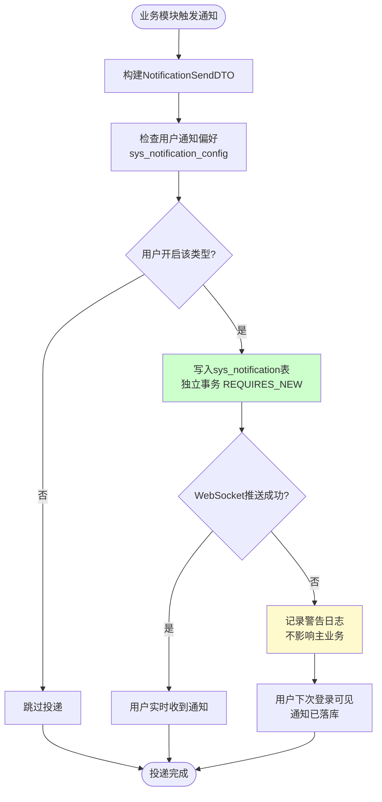

> **关键设计说明**：
> - 独立事务 `REQUIRES_NEW`：通知投递失败不回滚主业务事务
> - 静默投递：异常仅记录日志，不抛出给调用方
> - 兜底机制：WebSocket推送失败时消息已落库，用户登录后可见

### 6.2 批量通知投递（含优化建议）

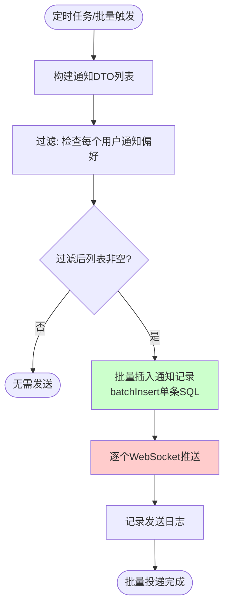

> **优化点（红色标记）**：当前WebSocket推送（G）仍为逐个循环，大量通知时可能阻塞。建议改为异步并行推送：
>
> ```java
> // 优化方案：使用并行流异步推送
> notifications.parallelStream().forEach(n -> {
>     try {
>         pushService.pushToUser(n.getUserId(), convertToVO(n));
>     } catch (Exception e) {
>         log.warn("[批量通知] 推送失败: userId={}, error={}", n.getUserId(), e.getMessage());
>     }
> });
> ```

### 6.3 定时任务到期通知流程

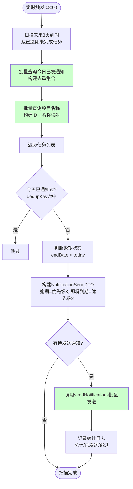

> **优化设计（绿色标记）**：
> - N+1查询优化：批量查询已发通知（C）和项目名称（D），避免逐条查询
> - 去重机制：同一任务同一天只通知一次，dedupKey = `taskId:assigneeId`
> - 批量发送：使用 `sendNotifications` 批量方法，减少数据库往返

---

## 7. 工作量管理流程（v1.1 新增）

工作量管理机制在任务进度审核流程基础上，引入"基准设定 → 实际回写 → 偏差检测"三段式闭环，实现项目工时量化跟踪与预警。

### 7.1 工作量基准设定流程

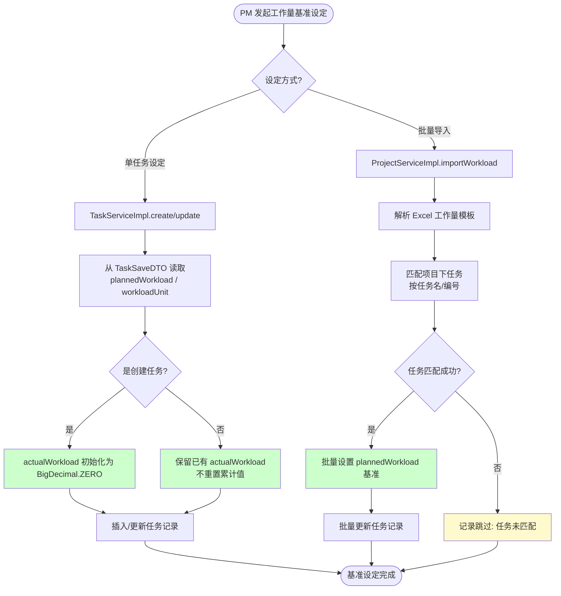

> **关键设计说明（绿色标记）**：
> - `create()` 时 `actualWorkload` 初始化为 0，`update()` 时保留累计实际值不重置，避免历史工时丢失
> - 基准设定复用现有任务 CRUD 路径，无需独立接口
> - `importWorkload()` 支持批量初始化，适配项目立项阶段的工作量估算

### 7.2 工作量审核回写流程

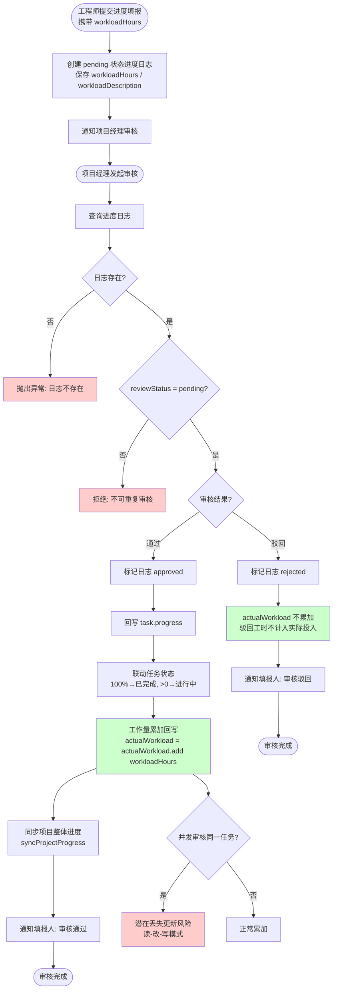

> **关键设计说明**：
> - 工作量累加（N，绿色）复用现有审核流程，仅在通过分支增加 `BigDecimal.add()` 累加，侵入性小
> - 驳回工时不累加（S，绿色），确保 `actualWorkload` 仅反映已审核通过的真实投入
> - **并发风险（W，红色）**：`actualWorkload` 累加采用读-改-写模式，并发审核同一任务的不同进度日志时可能丢失更新。建议添加 `@Version` 乐观锁原子累加（详见附录 O8）

### 7.3 工作量偏差检测流程

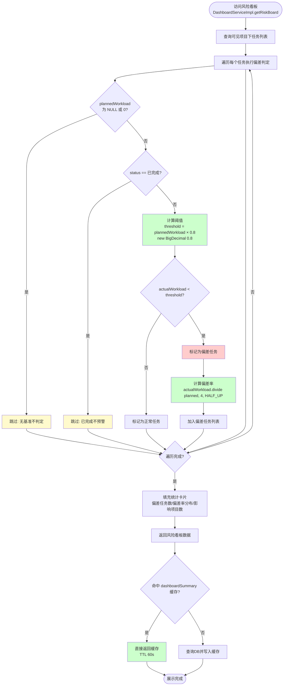

> **关键设计说明**：
> - 无基准/已完成任务跳过判定（黄色），避免无意义预警和历史数据噪声
> - 阈值 `0.8` 通过 `new BigDecimal("0.8")` 字符串构造（H，绿色），避免 double 精度损失
> - 偏差率使用 `divide(planned, 4, RoundingMode.HALF_UP)`（L，绿色），4 位小数四舍五入，展示稳定
> - 偏差任务标记为红色，前端风险看板红色高亮展示
> - `@Cacheable` 复用 `dashboardSummary` 缓存空间（R，绿色），TTL 60s，工作量数据同步延迟最多 60s

### 7.4 工作量统计与日报导出流程

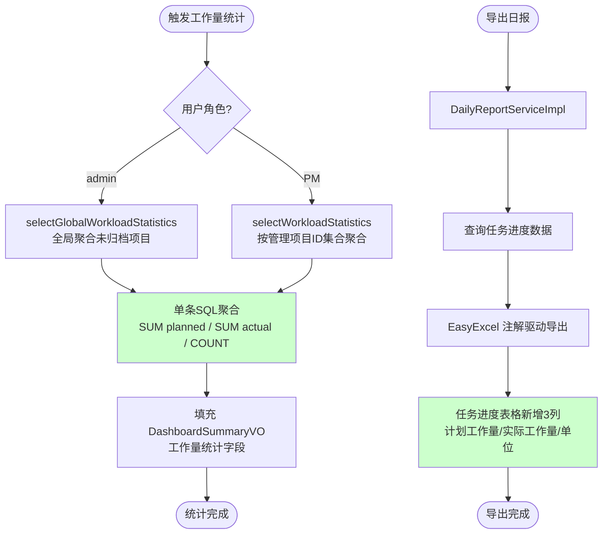

> **关键设计说明**：
> - 聚合统计使用单条 SQL（E，绿色），避免 Java 端循环累加，性能更优
> - 角色差异化：admin 全局聚合未归档项目，PM 聚合自己负责项目，复用现有数据隔离策略
> - 全局聚合通过 JOIN 项目表过滤 `is_archived = 0`，避免历史归档项目污染统计
> - 日报工作量列（L，绿色）复用 EasyExcel 注解驱动导出，无需额外模板配置

---

## 附录：优化点汇总

| 编号 | 所属流程 | 优化内容 | 优先级 | 代码位置 |
|------|----------|----------|--------|----------|
| O1 | 项目删除 | 级联清理关联数据（项目组/授权/图纸/归档） | 高 | [ProjectServiceImpl.delete](file:///c:/Users/QianLong/Desktop/Hbsz/Hbsz_IDC_System_end/src/main/java/com/example/hbsz_idc_system_end/service/impl/ProjectServiceImpl.java#L339-L366) |
| O2 | 项目更新 | 日期交叉校验合并DTO与已有日期 | 低 | [ProjectServiceImpl.update](file:///c:/Users/QianLong/Desktop/Hbsz/Hbsz_IDC_System_end/src/main/java/com/example/hbsz_idc_system_end/service/impl/ProjectServiceImpl.java#L246-L334) |
| O3 | 任务删除 | 校验子任务存在性 | 中 | [TaskServiceImpl.delete](file:///c:/Users/QianLong/Desktop/Hbsz/Hbsz_IDC_System_end/src/main/java/com/example/hbsz_idc_system_end/service/impl/TaskServiceImpl.java#L207-L217) |
| O4 | 进度同步 | 确认AVG SQL使用IFNULL兜底 | 中 | [TaskServiceImpl.syncProjectProgress](file:///c:/Users/QianLong/Desktop/Hbsz/Hbsz_IDC_System_end/src/main/java/com/example/hbsz_idc_system_end/service/impl/TaskServiceImpl.java#L688-L692) |
| O5 | 文档编号 | 使用UUID替代时间戳 | 低 | [DocumentServiceImpl.create](file:///c:/Users/QianLong/Desktop/Hbsz/Hbsz_IDC_System_end/src/main/java/com/example/hbsz_idc_system_end/service/impl/DocumentServiceImpl.java#L142-L177) |
| O6 | 文档版本 | 新增版本号唯一性校验 | 中 | [DocumentServiceImpl.addVersion](file:///c:/Users/QianLong/Desktop/Hbsz/Hbsz_IDC_System_end/src/main/java/com/example/hbsz_idc_system_end/service/impl/DocumentServiceImpl.java#L258-L280) |
| O7 | 批量通知 | WebSocket推送改为并行流 | 低 | [NotificationServiceImpl.sendNotifications](file:///c:/Users/QianLong/Desktop/Hbsz/Hbsz_IDC_System_end/src/main/java/com/example/hbsz_idc_system_end/service/impl/NotificationServiceImpl.java#L179-L227) |
| O8 | 工作量审核回写 | `actualWorkload` 累加改为 `@Version` 乐观锁原子累加，消除并发丢失更新风险 | 中 | [TaskServiceImpl.reviewProgress](file:///c:/Users/QianLong/Desktop/Hbsz/Hbsz_IDC_System_end/src/main/java/com/example/hbsz_idc_system_end/service/impl/TaskServiceImpl.java) |
